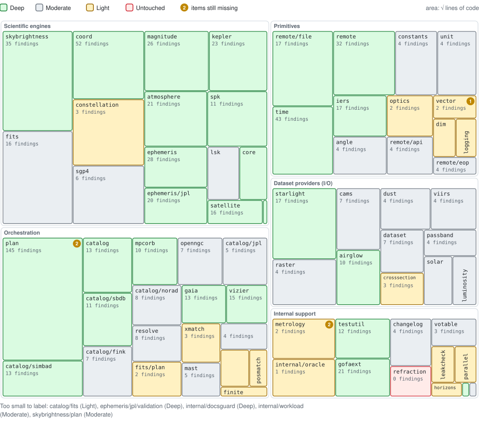
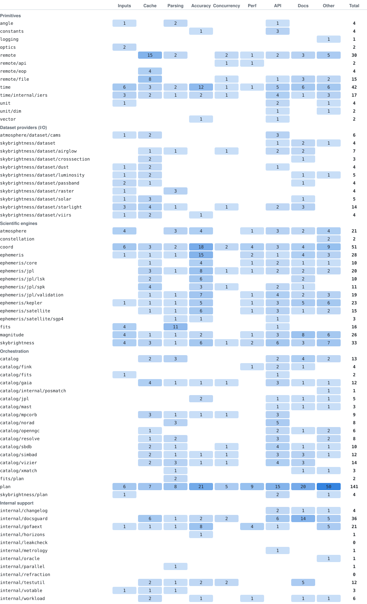

# Audit map

How deeply each package of astrogo has been audited, and what is still missing. Generated by [tools/](tools/) from main at `0e35ae51` (2026-11-11); do not edit by hand, regenerate it as the end of this page shows. [PLAN.md](PLAN.md) is how the missing items close.

<picture>
  <source media="(prefers-color-scheme: dark)" srcset="img/summary-dark.svg">
  
</picture>

397 findings fixed, each a GitHub issue closed by a commit on main, touch 68 of the module's 70 packages. By depth: 27 deep, 25 moderate, 16 light, 2 untouched. Median statement coverage is 92.7% across the 67 packages with statements. 14 closed bugs are not attributed to a package, because no commit on main that changed Go files closed them with a closing keyword: #109, #140, #660, #680, #685, #694, #885, #923, #942, #943, #1019, #1021, #1023, #1045.

## Package map

Each block is a package, grouped by layer. Area grows with the square root of lines of code, which keeps the order of sizes while leaving small packages room for their name; the few still too small are named under the map. Color is audit depth, and a badge counts the items still missing. Deep is 10 or more findings across 4 or more kinds of defect; Moderate is 4 or more findings, or 3 or more kinds; Light is 1 to 3 findings; Untouched is none.

<picture>
  <source media="(prefers-color-scheme: dark)" srcset="img/map-dark.svg">
  
</picture>

## What is still missing

8 items in 7 packages, most items first. They come from rules over the numbers (a parser of outside data with no fuzz target, coverage under 75%, few findings for a package's size, no finding about non-finite inputs where they matter) and from things an audit run saw and did not file.

| Package | Depth | Findings | Coverage | Still missing |
| --- | --- | ---: | ---: | --- |
| `plan` | Deep | 143 | 91.3% | Slew time converts a float to time.Duration unguarded; overflow needs a rate below 2e-8 deg/s (judged unreachable).<br>Open: #115 plan: 356 exported symbols in one package, plus three packages named plan |
| `internal/metrology` | Light | 1 | 93.4% | Light audit for its size: 1 findings in 633 lines. |
| `internal/oracle` | Light | 1 | 82.7% | Light audit for its size: 1 findings in 556 lines. |
| `ephemeris` | Deep | 28 | 92.1% | Open: #913 perf(ephemeris): Epv00 is evaluated again for an instant already asked for: 29 µs against 1.4 µs, and 69–77% of CPU in event and planet searches |
| `internal/refraction` | Untouched | 0 | 100.0% | No audit finding has ever touched it. |
| `vector` | Light | 2 | 100.0% | A magnitude beyond about 1e154 overflows to infinity when squared (judged unreachable: no astronomical vector here is near it). |
| `internal/leakcheck` | Untouched | 0 | 87.1% | No audit finding has ever touched it. |

## Findings by kind of defect

How many fixed findings of each kind touched each package. A blank is a kind the audit has not found there, which is either a clean bill or a check never run. Kinds are read from issue titles, so they are approximate.

<picture>
  <source media="(prefers-color-scheme: dark)" srcset="img/kinds-dark.svg">
  
</picture>

<details>
<summary>The same, as a table</summary>

| Package | Inputs | Cache | Parsing | Accuracy | Concurrency | Perf | API | Docs | Other | Total |
| --- | ---: | ---: | ---: | ---: | ---: | ---: | ---: | ---: | ---: | ---: |
| **Primitives** | | | | | | | | | | |
| `angle` | 1 |  | 2 |  |  |  | 1 |  |  | 4 |
| `constants` |  |  |  | 1 |  |  | 3 |  |  | 4 |
| `logging` |  |  |  |  |  |  |  |  | 1 | 1 |
| `optics` | 2 |  |  |  |  |  |  |  |  | 2 |
| `remote` |  | 15 | 2 |  | 3 | 1 | 2 | 4 | 5 | 32 |
| `remote/api` |  |  |  |  | 2 | 1 |  |  |  | 3 |
| `remote/eop` |  | 4 |  |  |  |  |  |  |  | 4 |
| `remote/file` |  | 8 |  |  | 1 |  | 1 | 5 | 2 | 17 |
| `time` | 6 | 3 | 2 | 12 | 1 | 1 | 5 | 6 | 6 | 42 |
| `time/internal/iers` | 3 | 2 | 1 | 2 | 1 |  | 4 | 1 | 3 | 17 |
| `unit` | 1 |  |  |  |  |  | 2 |  | 1 | 4 |
| `unit/dim` |  |  |  |  |  |  | 1 |  | 1 | 2 |
| `vector` |  |  |  | 1 |  |  | 1 |  |  | 2 |
| **Dataset providers (I/O)** | | | | | | | | | | |
| `atmosphere/dataset/cams` | 1 | 2 |  |  |  |  | 3 | 1 |  | 7 |
| `skybrightness/dataset` | 1 | 1 |  |  |  |  | 1 | 3 | 1 | 7 |
| `skybrightness/dataset/airglow` | 1 | 2 | 1 |  | 2 |  | 2 | 2 |  | 10 |
| `skybrightness/dataset/crosssection` |  | 2 |  |  |  |  |  | 1 |  | 3 |
| `skybrightness/dataset/dust` | 1 | 2 |  |  |  |  | 1 |  |  | 4 |
| `skybrightness/dataset/luminosity` | 1 | 2 |  |  |  |  |  | 1 | 1 | 5 |
| `skybrightness/dataset/passband` | 2 | 1 |  |  |  |  |  | 1 |  | 4 |
| `skybrightness/dataset/raster` | 1 |  | 3 |  |  |  |  |  |  | 4 |
| `skybrightness/dataset/solar` | 1 | 3 |  |  |  |  |  | 1 |  | 5 |
| `skybrightness/dataset/starlight` | 5 | 4 | 1 |  | 1 |  | 2 | 3 | 1 | 17 |
| `skybrightness/dataset/viirs` | 1 | 2 |  | 1 |  |  |  |  |  | 4 |
| **Scientific engines** | | | | | | | | | | |
| `atmosphere` | 4 |  | 3 | 4 |  | 1 | 3 | 2 | 4 | 21 |
| `constellation` | 1 |  |  |  |  |  |  |  | 2 | 3 |
| `coord` | 6 | 3 | 2 | 18 | 2 | 4 | 3 | 4 | 9 | 51 |
| `ephemeris` | 1 | 1 | 1 | 15 |  | 2 | 1 | 4 | 3 | 28 |
| `ephemeris/core` |  | 1 |  | 4 |  | 1 | 2 | 1 | 1 | 10 |
| `ephemeris/jpl` |  | 3 | 1 | 8 | 1 | 1 | 2 | 2 | 2 | 20 |
| `ephemeris/jpl/lsk` |  | 2 |  | 6 |  |  |  | 2 |  | 10 |
| `ephemeris/jpl/spk` |  | 4 |  | 3 | 1 |  | 2 | 1 |  | 11 |
| `ephemeris/jpl/validation` |  | 1 | 1 | 7 |  | 1 | 4 | 2 | 3 | 19 |
| `ephemeris/kepler` | 1 | 1 | 1 | 5 |  | 1 | 3 | 5 | 6 | 23 |
| `ephemeris/satellite` | 1 | 1 | 1 | 6 |  | 1 | 3 | 1 | 2 | 16 |
| `ephemeris/satellite/sgp4` | 1 |  | 1 | 1 |  |  | 2 | 1 |  | 6 |
| `fits` | 4 |  | 11 |  |  |  | 1 |  |  | 16 |
| `magnitude` | 4 | 1 | 1 | 2 |  | 1 | 3 | 8 | 6 | 26 |
| `skybrightness` | 4 | 3 | 1 | 6 | 1 | 2 | 6 | 3 | 8 | 34 |
| **Orchestration** | | | | | | | | | | |
| `catalog` |  | 2 | 3 |  |  |  | 2 | 4 | 2 | 13 |
| `catalog/fink` | 1 |  | 1 |  |  | 1 | 3 | 1 |  | 7 |
| `catalog/fits` | 2 |  |  |  |  |  | 1 |  |  | 3 |
| `catalog/gaia` | 1 | 4 | 1 | 1 | 1 |  | 3 | 1 | 1 | 13 |
| `catalog/internal/finite` | 1 |  |  |  |  |  |  |  |  | 1 |
| `catalog/internal/posmatch` |  |  |  |  |  |  |  |  | 1 | 1 |
| `catalog/jpl` |  |  |  | 2 |  |  | 1 | 1 | 1 | 5 |
| `catalog/mast` | 1 |  |  |  |  |  | 1 | 1 | 1 | 4 |
| `catalog/mpcorb` | 1 | 3 | 1 | 1 | 1 |  | 3 |  |  | 10 |
| `catalog/norad` |  |  | 3 |  |  |  | 5 |  |  | 8 |
| `catalog/openngc` | 1 | 1 |  |  |  |  | 2 | 1 | 2 | 7 |
| `catalog/resolve` |  | 1 | 2 |  |  |  | 3 |  | 2 | 8 |
| `catalog/sbdb` |  | 2 | 2 |  | 1 |  | 4 | 1 | 1 | 11 |
| `catalog/simbad` | 1 | 2 | 1 | 1 | 1 |  | 3 | 3 | 1 | 13 |
| `catalog/vizier` | 1 | 2 | 3 | 1 | 1 |  | 4 | 3 |  | 15 |
| `catalog/xmatch` |  |  | 1 |  |  |  |  | 1 | 1 | 3 |
| `fits/plan` |  |  | 2 |  |  |  |  |  |  | 2 |
| `plan` | 7 | 7 | 8 | 21 | 5 | 9 | 15 | 21 | 50 | 143 |
| `skybrightness/plan` | 1 |  |  |  |  |  | 2 |  | 1 | 4 |
| **Internal support** | | | | | | | | | | |
| `internal/changelog` |  |  |  |  |  |  | 2 | 1 | 1 | 4 |
| `internal/docsguard` |  | 6 | 1 | 2 | 2 |  | 6 | 15 | 5 | 37 |
| `internal/gofaext` | 1 | 1 | 1 | 8 |  | 4 | 1 |  | 5 | 21 |
| `internal/horizons` |  |  |  | 1 |  |  |  |  |  | 1 |
| `internal/leakcheck` |  |  |  |  |  |  |  |  |  | 0 |
| `internal/metrology` |  |  |  |  |  |  | 1 |  |  | 1 |
| `internal/oracle` |  |  |  |  |  |  |  |  | 1 | 1 |
| `internal/parallel` |  |  | 1 |  |  |  |  |  |  | 1 |
| `internal/refraction` |  |  |  |  |  |  |  |  |  | 0 |
| `internal/testutil` |  | 2 | 1 | 2 | 2 |  |  | 5 |  | 12 |
| `internal/votable` | 1 | 1 | 1 |  |  |  |  |  |  | 3 |
| `internal/workload` |  | 2 |  | 1 |  | 1 |  | 1 | 1 | 6 |

</details>

## Depth by package

<details>
<summary>Every package with its depth, coverage, size and fuzz targets</summary>

### Primitives

| Package | Depth | Findings | Kinds | Coverage | Lines | Fuzz targets | Missing |
| --- | --- | ---: | ---: | ---: | ---: | ---: | ---: |
| `angle` | Moderate | 4 | 3 | 94.7% | 361 | 0 |  |
| `constants` | Moderate | 4 | 2 | 100.0% | 638 | 0 |  |
| `logging` | Light | 1 | 0 | 100.0% | 55 | 0 |  |
| `optics` | Light | 2 | 1 | 91.4% | 315 | 0 |  |
| `remote` | Deep | 32 | 6 | 90.5% | 1,375 | 0 |  |
| `remote/api` | Light | 3 | 2 | 88.7% | 266 | 0 |  |
| `remote/eop` | Moderate | 4 | 1 | 92.6% | 51 | 0 |  |
| `remote/file` | Deep | 17 | 4 | 84.1% | 1,812 | 0 |  |
| `time` | Deep | 42 | 8 | 96.0% | 1,490 | 0 |  |
| `time/internal/iers` | Deep | 17 | 7 | 95.9% | 424 | 1 |  |
| `unit` | Moderate | 4 | 2 | 90.8% | 551 | 0 |  |
| `unit/dim` | Light | 2 | 1 | 100.0% | 66 | 0 |  |
| `vector` | Light | 2 | 2 | 100.0% | 89 | 0 | 1 |

### Dataset providers (I/O)

| Package | Depth | Findings | Kinds | Coverage | Lines | Fuzz targets | Missing |
| --- | --- | ---: | ---: | ---: | ---: | ---: | ---: |
| `atmosphere/dataset/cams` | Moderate | 7 | 4 | 90.7% | 662 | 1 |  |
| `skybrightness/dataset` | Moderate | 7 | 4 | 78.2% | 316 | 0 |  |
| `skybrightness/dataset/airglow` | Deep | 10 | 6 | 84.1% | 528 | 1 |  |
| `skybrightness/dataset/crosssection` | Light | 3 | 2 | 88.1% | 179 | 1 |  |
| `skybrightness/dataset/dust` | Moderate | 4 | 3 | 94.8% | 391 | 1 |  |
| `skybrightness/dataset/luminosity` | Moderate | 5 | 3 | 94.9% | 125 | 1 |  |
| `skybrightness/dataset/passband` | Moderate | 4 | 3 | 91.5% | 176 | 1 |  |
| `skybrightness/dataset/raster` | Moderate | 4 | 2 | 89.5% | 778 | 1 |  |
| `skybrightness/dataset/solar` | Moderate | 5 | 3 | 84.5% | 176 | 1 |  |
| `skybrightness/dataset/starlight` | Deep | 17 | 6 | 77.2% | 1,865 | 3 |  |
| `skybrightness/dataset/viirs` | Moderate | 4 | 3 | 85.6% | 327 | 1 |  |

### Scientific engines

| Package | Depth | Findings | Kinds | Coverage | Lines | Fuzz targets | Missing |
| --- | --- | ---: | ---: | ---: | ---: | ---: | ---: |
| `atmosphere` | Deep | 21 | 6 | 96.2% | 999 | 0 |  |
| `constellation` | Light | 3 | 1 | 96.7% | 1,848 | 0 |  |
| `coord` | Deep | 51 | 8 | 95.9% | 1,957 | 0 |  |
| `ephemeris` | Deep | 28 | 7 | 92.1% | 549 | 0 | 1 |
| `ephemeris/core` | Deep | 10 | 5 | 92.7% | 183 | 0 |  |
| `ephemeris/jpl` | Deep | 20 | 7 | 80.0% | 433 | 0 |  |
| `ephemeris/jpl/lsk` | Moderate | 10 | 3 | 93.1% | 237 | 1 |  |
| `ephemeris/jpl/spk` | Deep | 11 | 5 | 88.3% | 911 | 3 |  |
| `ephemeris/jpl/validation` | Deep | 19 | 6 | — | 0 | 0 |  |
| `ephemeris/kepler` | Deep | 23 | 7 | 95.8% | 1,016 | 0 |  |
| `ephemeris/satellite` | Deep | 16 | 7 | 94.8% | 147 | 2 |  |
| `ephemeris/satellite/sgp4` | Moderate | 6 | 5 | 99.1% | 1,439 | 2 |  |
| `fits` | Moderate | 16 | 3 | 89.4% | 3,491 | 3 |  |
| `magnitude` | Deep | 26 | 7 | 89.0% | 1,238 | 0 |  |
| `skybrightness` | Deep | 34 | 8 | 86.2% | 4,032 | 0 |  |

### Orchestration

| Package | Depth | Findings | Kinds | Coverage | Lines | Fuzz targets | Missing |
| --- | --- | ---: | ---: | ---: | ---: | ---: | ---: |
| `catalog` | Deep | 13 | 4 | 92.1% | 621 | 0 |  |
| `catalog/fink` | Moderate | 7 | 5 | 88.2% | 519 | 1 |  |
| `catalog/fits` | Light | 3 | 2 | 93.0% | 96 | 0 |  |
| `catalog/gaia` | Deep | 13 | 7 | 89.2% | 245 | 1 |  |
| `catalog/internal/finite` | Light | 1 | 1 | 100.0% | 18 | 0 |  |
| `catalog/internal/posmatch` | Light | 1 | 0 | 100.0% | 38 | 0 |  |
| `catalog/jpl` | Moderate | 5 | 3 | 94.1% | 380 | 1 |  |
| `catalog/mast` | Moderate | 4 | 3 | 95.5% | 152 | 1 |  |
| `catalog/mpcorb` | Deep | 10 | 6 | 96.0% | 391 | 1 |  |
| `catalog/norad` | Moderate | 8 | 2 | 93.8% | 333 | 1 |  |
| `catalog/openngc` | Moderate | 7 | 4 | 93.6% | 384 | 1 |  |
| `catalog/resolve` | Moderate | 8 | 3 | 95.7% | 273 | 0 |  |
| `catalog/sbdb` | Deep | 11 | 5 | 95.0% | 580 | 1 |  |
| `catalog/simbad` | Deep | 13 | 7 | 91.3% | 705 | 1 |  |
| `catalog/vizier` | Deep | 15 | 7 | 88.0% | 210 | 1 |  |
| `catalog/xmatch` | Light | 3 | 2 | 98.1% | 196 | 0 |  |
| `fits/plan` | Light | 2 | 1 | 87.2% | 250 | 0 |  |
| `plan` | Deep | 143 | 8 | 91.3% | 8,137 | 1 | 2 |
| `skybrightness/plan` | Moderate | 4 | 2 | 84.3% | 128 | 0 |  |

### Internal support

| Package | Depth | Findings | Kinds | Coverage | Lines | Fuzz targets | Missing |
| --- | --- | ---: | ---: | ---: | ---: | ---: | ---: |
| `internal/changelog` | Moderate | 4 | 2 | 93.9% | 382 | 0 |  |
| `internal/docsguard` | Deep | 37 | 6 | — | 1 | 0 |  |
| `internal/gofaext` | Deep | 21 | 6 | 78.0% | 432 | 0 |  |
| `internal/horizons` | Light | 1 | 1 | 100.0% | 18 | 0 |  |
| `internal/leakcheck` | Untouched | 0 | 0 | 87.1% | 68 | 0 | 1 |
| `internal/metrology` | Light | 1 | 1 | 93.4% | 633 | 0 | 1 |
| `internal/oracle` | Light | 1 | 0 | 82.7% | 556 | 0 | 1 |
| `internal/parallel` | Light | 1 | 1 | 100.0% | 64 | 0 |  |
| `internal/refraction` | Untouched | 0 | 0 | 100.0% | 158 | 0 | 1 |
| `internal/testutil` | Deep | 12 | 5 | 88.3% | 478 | 0 |  |
| `internal/votable` | Moderate | 3 | 3 | 94.5% | 154 | 1 |  |
| `internal/workload` | Moderate | 6 | 4 | — | 1 | 0 |  |

</details>

## Sweeps

Systematic checks, each for one class of defect across the scope shown.

| Date | Sweep | Scope | Outcome | Issues |
| --- | --- | --- | --- | --- |
| 2026-11-10 | Non-finite values in third-party parsers | skybrightness/dataset/*, time/internal/iers, catalog parsers | 4 issues fixed; non-finite coordinates in catalog parsers seen and not filed | #1030 #1032 #1033 #1037 |
| 2026-11-10 | Range checks that let infinity through | whole module (grep, then a probe per site) | 8 functions fixed; 2 rejected as already refusing the result | #1038 |
| 2026-11-10 | Cached copies a provider's parser refuses | all 12 remote.GetFile callers | 2 providers fixed; MPCORB, OpenNGC and the rest already heal | #1015 #1043 |
| 2026-11-10 | Parsers that accept an error page as an empty file | IERS, MPC codes, LSK, OpenNGC, luminosity, cross sections, solar, airglow | 1 parser fixed (IERS); the others refuse it | #1042 |
| 2026-11-11 | Refused updates deleting the cached copy | remote.WithRead, every mutable endpoint | Fixed in remote for every provider | #1047 |
| 2026-11-10 | Fuzz targets whose queries come from parsed data | all 24 fuzz packages | 1 blind target fixed (IERS); the others query fixed inputs | #1037 |
| 2026-11-10 | Tests whose comments admit a defect | every _test.go | 2 tests rewritten to test the fix | #1042 #1044 |
| 2026-11-10 | Float to integer and Duration conversions | whole module | 1 site, judged unreachable; not filed |  |
| 2026-11-10 | Upstream service drift | Horizons, SIMBAD | SIMBAD outage now skips; Horizons CSV recovered; Horizons TDB−UT freeze reported to JPL, which fixed it on 11 November | #1023 #1026 #1045 |
| 2026-11-11 | SGP4 against an independent implementation | ephemeris/satellite/sgp4: python-sgp4's C++ over 5,000 synthetic element sets, and non-finite fields | Propagation agrees; an At hang on resonant orbits and doc drift fixed | #1052 #1054 |
| 2026-11-11 | Constellation boundaries against Roman's table | constellation: 250,000 points, boundaries, poles and the 0h/24h wrap; astropy compared | 2 points disagree, each within 0.2″ of a boundary; a NaN position fixed | #1055 |
| 2026-11-11 | Non-finite inputs, remaining numeric packages | vector, ephemeris/core, ephemeris/jpl, ephemeris/satellite, every catalog parser | 3 packages clean; satellite fixed; catalog parsers read a non-finite number as absent | #1052 #1080 |
| 2026-11-11 | Fuzz targets for the remaining parsers of outside data | catalog/fink, catalog/mast, catalog/sbdb, skybrightness/dataset/viirs | 3 defects fixed, 2 of them panics; xmatch reads no bytes and needs none | #1058 #1061 #1062 |
| 2026-11-11 | Coverage of six packages to 75% | skybrightness/dataset, starlight, airglow, logging, catalog/internal/posmatch, catalog/mast | All six at 77% or more; 10 defects found, 9 fixed, 1 awaiting a decision | #1066 #1067 #1068 #1069 #1077 #1078 #1079 #1088 #1089 #1090 |

## How it is measured

- **Findings** are issues closed by a commit on main whose message says "Closes #N". One is counted for every package whose Go files that commit changed, so a finding that crossed two packages counts in both.
- **Kinds of defect** are read from each issue's title by keyword, the first matching kind winning.
- **Coverage** is `go test -cover` on the untagged suite.
- **Gaps** are rules over these numbers plus the judgments in [tools/judgments.py](tools/judgments.py): which packages decode outside bytes, which take floating-point inputs where non-finite values matter, which were swept and found clean, and what was seen and not filed.

## Regenerating

From the repository root, with Python 3 and an authenticated `gh`:

```bash
python docs/audit/tools/collect.py   # facts: packages, sources, issues, go test -cover
python docs/audit/tools/build.py     # tables: packages, findings, sweeps
python docs/audit/tools/render.py    # this page and its charts; --check reports a stale one
```

`collect.py` runs the untagged test suite for coverage; pass `--cover-from FILE` to read a saved `go test -cover ./...` output instead.
